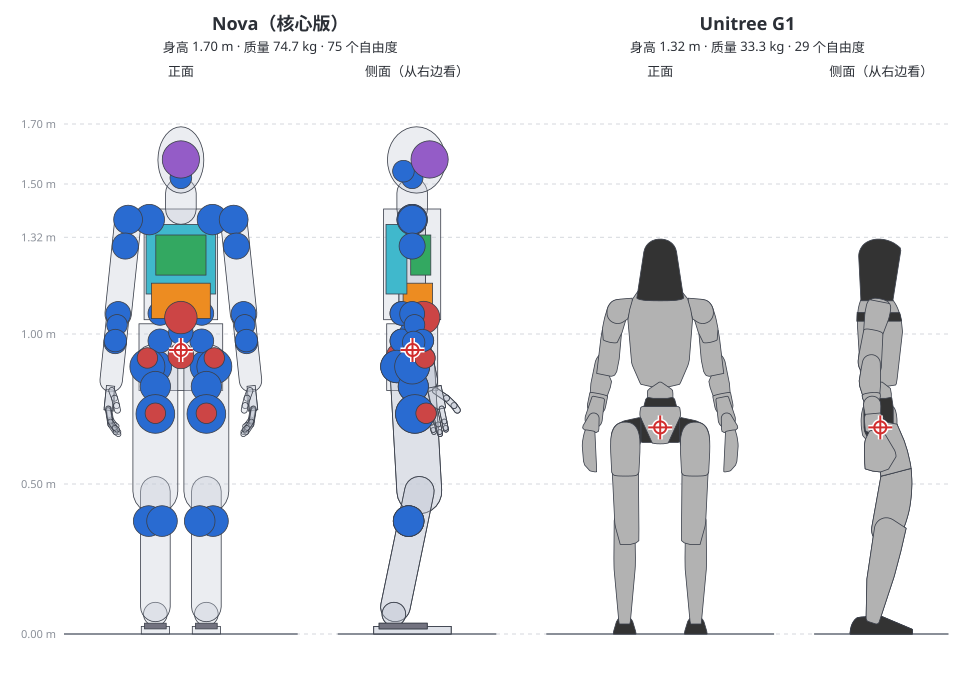

# 基线的身体：Unitree G1

**这份报告和图是程序生成的，不要手改。** 要改就改 `body/nova_body` 里的代码，再运行：

```bash
docker compose run --rm body python -m nova_body.baseline_report
```

基线是一个现成的身体。把它和 Nova 放上同一个测试台、跑同一套测试，Nova 每加一样东西都有得比（[核心和待证明](../核心和待证明.md)第 2 节）。



## 1. 结论

**同一套测试，两个身体都过了。**
这里说的测试是：用关节控制站 10 秒（合格线一样），不给控制就倒。
别的几条（模型的质量和来源对得上、传感器读数合理、仿真比实时快）在自动测试里查，两个身体跑的也是同一套。

| 项目 | Nova（核心版） | Unitree G1 |
|---|---|---|
| 身高 | 1.70 m | 1.32 m |
| 质量 | 74.71 kg | 33.34 kg |
| 自由度 | 75 | 29 |
| 驱动器 | 67 | 29 |
| 用关节控制站 10 秒 | 站住了：最多歪 0.007° | 站住了：最多歪 0.004° |
| 驱动器不出力 | 0.37 秒后倒了 | 0.28 秒后倒了 |
| 往前推，最多扛得住 | 体重的 10%（73 N） | 体重的 6%（20 N） |
| 往侧面推，最多扛得住 | 体重的 8%（59 N） | 体重的 14%（46 N） |
| 躯干竖直时，膝最多能弯到 | 86° | 97° |

推力按体重的比例算：同样是体重的 4%，重的身体受的力大。
仿真比实时快多少，每次运行不一样，所以不写在这里；量出来的数记在 [P1 计划](../P1计划.md)。

## 2. 基线是什么、从哪来

| 项目 | 内容 |
|---|---|
| 模型文件 | MuJoCo Menagerie 里的 `unitree_g1/g1.xml`：29 个自由度的 G1，没有灵巧手 |
| 从哪来 | https://github.com/google-deepmind/mujoco_menagerie |
| 版本 | 提交 `cda5236f9838`（2026-10-20），写死在 `third_party/unitree_g1.json` |
| 许可证 | BSD-3-Clause（可以商用；许可证的原文和模型放在一起） |
| 文件 | 37 个，19.7 MB。不提交进仓库，用 `docker compose run --rm body python -m nova_body.third_party` 下载；每次用之前都核对每个文件的 SHA-256 |
| 厂家写的 | 身高 1.32 m，约 35 kg（带电池） |
| 模型里量到的 | 身高 1.32 m；33.34 kg（文件里各段质量加起来，比厂家写的轻 1.7 kg） |

放上测试台时：

- **没有改的（身体本身）**：各段的质量和惯量、关节的位置和范围、电机的峰值力矩、关节的摩擦、转子的惯量、碰撞的形状。模型文件一个字都不改。
- **换成和 Nova 一样的（测试台定的）**：地面、仿真的步长、关节位置控制的软硬、站姿的算法。文件里自带的软硬是没有调过的（每个关节都是 500 N·m/rad），自带的站姿腿是直的；自带的站姿改名叫 `published_stand` 留着，用它原样也站得住。
- **加上的**：每只脚底正中间的一个点（量脚滑了多少、算站姿用），每个关节的位置、速度、力矩的传感器。

## 3. 站姿

两个身体用同一个办法算：膝弯 15°；髋和踝配合着让躯干竖直、脚底贴地；踝的角度是算出来的，让重心正好在两只脚的正中间上面。手臂放在各自放松的位置上。

| 项目 | Nova（核心版） | Unitree G1 |
|---|---|---|
| 膝 | 弯 15.0° | 弯 15.0° |
| 踝 | 脚尖向上 11.7° | 脚尖向上 10.6° |
| 髋 | 向前抬 3.3° | 向前抬 4.4° |
| 重心的高度 | 0.944 m（身高的 0.56） | 0.689 m（身高的 0.52） |
| 脚底着地的那一段 | 长 25.8 cm | 长 18.0 cm |
| 踝最多能让脚尖向上 | 45° | 50° |
| 躯干竖直时，膝最多能弯到 | 86° | 97° |

最后两行：躯干竖直、脚底贴地的时候，膝弯得越多，踝就要让脚尖向上越多，重心才能留在脚的中间上面。所以踝能转多少，就定了这样能蹲多深。要蹲得再深，得让身体往前倾（[力量的报告](力量.md)里的"蹲到底再站起"就是这样做的）。

站着时最费力的 4 个关节（左右一样的只列左侧）：

**Nova（核心版）**

| 关节 | 出的力矩 | 是峰值的 |
|---|---|---|
| 踝 前后 | 22.4 N·m | 9.1% |
| 膝 | 6.6 N·m | 1.8% |
| 腰 前后 | 2.8 N·m | 1.4% |
| 肩 侧摆 | 1.8 N·m | 1.7% |

**Unitree G1**

| 关节 | 出的力矩 | 是峰值的 |
|---|---|---|
| 踝 前后 | 5.6 N·m | 11.2% |
| 膝 | 2.8 N·m | 2.0% |
| 肩 侧摆 | 1.4 N·m | 5.6% |
| 腰 前后 | 0.8 N·m | 1.6% |

## 4. 站 10 秒

每个关节的驱动器顶在站姿的角度上（位置控制），没有平衡的控制。合格线两个身体一样。

| 项目 | Nova（核心版） | Unitree G1 | 合格线 |
|---|---|---|---|
| 倒了没有 | 没倒 | 没倒 | 不倒 |
| 骨盆最多歪了 | 0.007° | 0.004° | < 2° |
| 骨盆最多低了 | 0.10 mm | 0.06 mm | < 5 mm |
| 脚滑了 | 0.06 mm | 0.01 mm | < 1 mm |
| 最后关节的速度 | 0.0000 rad/s | 0.0000 rad/s | < 0.001 rad/s |
| 地面托着的重量 | 74.71 kg | 33.34 kg | 等于体重 |
| 压力中心 | 在脚跟前面 12.9 cm（脚底长 25.8 cm） | 在脚跟前面 9.0 cm（脚底长 18.0 cm） | 在脚底里面 |
| 驱动器不出力 | 0.37 秒后倒了 | 0.28 秒后倒了 | 会倒 |

不给控制马上就倒，说明是关节的控制让它们站住的。

## 5. 推一下

站稳以后在胸上推 0.5 秒。力从体重的 2% 起，每档加 2%，推到倒了为止（倒了以后更大的就不试了，写成 -）。没倒的写最多歪了多少度。

| 推力是体重的 | Nova（核心版） 往前 | Nova（核心版） 往侧面 | Unitree G1 往前 | Unitree G1 往侧面 |
|---|---|---|---|---|
| 2% | 0.6° | 0.1° | 1.0° | 0.0° |
| 4% | 1.2° | 0.2° | 2.0° | 0.0° |
| 6% | 1.8° | 1.0° | 4.1° | 0.1° |
| 8% | 3.0° | 2.3° | 倒了 | 0.1° |
| 10% | 6.9° | 倒了 | - | 0.4° |
| 12% | 倒了 | - | - | 1.2° |
| 14% | - | - | - | 4.3° |
| 16% | - | - | - | 倒了 |

两个身体都是稍微用力一推就倒：现在只是关节顶着，没有平衡的控制。被推了还能站住，要靠小脑层的平衡控制，是下一阶段（P2）的事。到那时这张表就是比较的起点。

## 6. G1 的关节

一共 29 个，每个都有驱动器。左右两侧一样，下面只列中间的和左侧的。范围和峰值力矩是模型文件里的。
刚度是测试台定的，和 Nova 同一条规则：关节偏了 0.1 弧度（约 6°）就出全力，阻尼 = 刚度 x 0.05 秒。这不是 G1 出厂的设置。

| 关节 | 范围 | 峰值力矩 | 刚度 |
|---|---|---|---|
| 髋 前后 | -145° ~ 165° | 88 N·m | 880 N·m/rad |
| 髋 侧摆 | -30° ~ 170° | 139 N·m | 1390 N·m/rad |
| 髋 转 | -158° ~ 158° | 88 N·m | 880 N·m/rad |
| 膝 | -5° ~ 165° | 139 N·m | 1390 N·m/rad |
| 踝 前后 | -50° ~ 30° | 50 N·m | 500 N·m/rad |
| 踝 侧 | -15° ~ 15° | 50 N·m | 500 N·m/rad |
| 腰 转 | -150° ~ 150° | 88 N·m | 880 N·m/rad |
| 腰 侧弯 | -30° ~ 30° | 50 N·m | 500 N·m/rad |
| 腰 前后 | -30° ~ 30° | 50 N·m | 500 N·m/rad |
| 肩 前后 | -177° ~ 153° | 25 N·m | 250 N·m/rad |
| 肩 侧摆 | -91° ~ 129° | 25 N·m | 250 N·m/rad |
| 肩 转 | -150° ~ 150° | 25 N·m | 250 N·m/rad |
| 肘 | -60° ~ 120° | 25 N·m | 250 N·m/rad |
| 前臂转 | -113° ~ 113° | 25 N·m | 250 N·m/rad |
| 腕 上下 | -93° ~ 93° | 5 N·m | 50 N·m/rad |
| 腕 左右 | -93° ~ 93° | 5 N·m | 50 N·m/rad |

## 7. 看这份报告要记住的

- **比的只是站着。** 走、被推以后恢复、摔倒后起来是 P2 的事，家务是 P3 以后的事。基线真正的用处在那时候：它有现成的、练好的权重。
- **G1 没有手指。** 这个模型的手是一块橡胶的手掌，所以它只有 29 个自由度；Nova 的两只手就有 44 个。要比抓东西（P4），得给基线另找手的模型。
- **G1 的头和颈不能动**，模型里也没有相机、脚底和手腕的力传感器、皮肤。它自己的传感器只有两个 IMU（骨盆、躯干）；关节的位置、速度、力矩是测试台加的（真机的电机也会报这三样）。
- **关节的软硬是测试台定的同一条规则**，不是 G1 出厂的，也不是 Nova 最后会用的。所以"扛得住多大的推力"现在主要看身体的比例（脚多长、重心多高），不看控制得好不好。
- **地面由测试台定。** 和地面的摩擦、软硬都用地面的；G1 的模型给自己的脚写的摩擦（0.6）在这里不起作用。这样同一块地面对两个身体才是一样的。
- **仿真的步长是 1 毫秒**，两个身体一样（G1 的文件自己写的步长不用）。
- **G1 的网格只用来看。** 图上画的是每个网格的凸包，只有大的轮廓。
