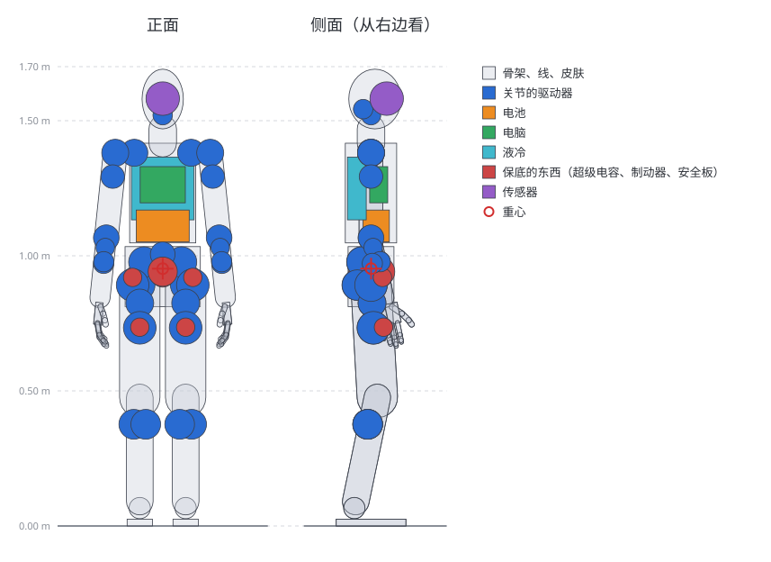

# 身体的模型（核心版）

**这份报告和图是程序生成的，不要手改。** 要改就改 `body/nova_body` 里的数据，再运行：

```bash
docker compose run --rm body python -m nova_body.model_report
```



## 1. 结论

| 项目 | 结果 |
|---|---|
| 自由度 | 75（两只手 44，身体 31） |
| 驱动器 | 67（身体 31，每只手 18；每只手有 4 个远指间跟着近指间动） |
| 身高 | 1.70 m |
| 模型的总质量 | 74.71 kg（质量闭环算的是 74.71 kg） |
| 传感器 | 254 个，一共 328 个数；相机 5 台（还没有画面） |
| 用关节控制站 10 秒 | 站住了：最多歪 0.01°，骨盆低了 0.1 mm |
| 仿真的步长 | 1 毫秒（每秒 1000 步） |

仿真比实时快多少，每次运行不一样，所以不写在这里；量出来的数记在 [P1 计划](../P1计划.md)。

## 2. 站姿

膝微弯；髋和踝配合着让躯干竖直、脚底贴地；踝的角度是算出来的，让重心正好在两只脚的正中间上面。

| 项目 | 值 |
|---|---|
| 膝 | 弯 15.0° |
| 踝 | 脚尖向上 11.7° |
| 髋 | 向前抬 3.3° |
| 骨盆（髋关节）的高度 | 0.892 m |
| 重心的高度 | 0.944 m（身高的 0.56；人约 0.55~0.57） |

驱动器的目标里带着顶住重力要的力矩，所以站姿正好是平衡的位置，身体不会往下沉。
站着时最费力的 6 个关节（左右一样的只列左侧）：

| 关节 | 出的力矩 | 是峰值的 |
|---|---|---|
| 踝 前后 | 22.4 N·m | 9.1% |
| 膝 | 6.6 N·m | 1.8% |
| 腰 前后 | 2.8 N·m | 1.4% |
| 肩 侧摆 | 1.8 N·m | 1.7% |
| 肩 前后 | 1.2 N·m | 0.8% |
| 肘 | 1.2 N·m | 2.6% |

## 3. 站 10 秒

每个关节的驱动器顶在站姿的角度上（位置控制），没有平衡的控制。

| 项目 | 结果 | 合格线 |
|---|---|---|
| 倒了没有 | 没倒 | 不倒 |
| 骨盆最多歪了 | 0.01° | < 2° |
| 骨盆最多低了 | 0.1 mm | < 5 mm |
| 脚滑了 | 0.06 mm | < 1 mm |
| 最后关节的速度 | 0.0000 rad/s | < 0.001 rad/s |
| 地面托着的重量 | 74.71 kg | 等于体重 74.71 kg |
| 压力中心 | 在脚跟前面 12.9 cm（脚长 25.8 cm） | 在脚底里面 |

对照：

| 情况 | 结果 |
|---|---|
| 驱动器不出力 | 0.37 秒后倒了 |
| 在胸上往前推 30 N、0.5 秒 | 没倒，最多歪 1.2° |
| 在胸上往后推 30 N、0.5 秒 | 没倒，最多歪 1.2° |
| 在胸上往左推 30 N、0.5 秒 | 没倒，最多歪 0.2° |
| 在胸上往右推 30 N、0.5 秒 | 没倒，最多歪 0.2° |
| 在胸上往前推 300 N、0.5 秒 | 倒了 |

不给控制马上就倒，说明是关节的控制让它站住的。用力推会倒，因为现在只是关节顶着；被推了还能站住，要靠小脑层的平衡控制，是下一阶段（P2）的事。

## 4. 各段的长度和质量

质量是一侧的。每一段 = 这一段里的驱动器和别的东西 + 分到这一段的骨架、线和皮肤。

| 段 | 长度 | 质量 | 驱动器和别的东西 | 骨架、线、皮肤 |
|---|---|---|---|---|
| 头和颈 | 0.309 m | 3.47 kg | 1.99 kg | 1.49 kg |
| 胸和腹 | 0.347 m | 19.15 kg | 12.23 kg | 6.92 kg |
| 骨盆 | 0.142 m | 15.24 kg | 12.85 kg | 2.39 kg |
| 上臂 | 0.316 m | 3.36 kg | 2.78 kg | 0.58 kg |
| 前臂 | 0.248 m | 1.88 kg | 1.53 kg | 0.35 kg |
| 手 | 0.184 m | 1.13 kg | 1.00 kg | 0.13 kg |
| 大腿 | 0.416 m | 7.44 kg | 4.41 kg | 3.03 kg |
| 小腿 | 0.418 m | 3.72 kg | 2.79 kg | 0.93 kg |
| 脚 | 0.066 m | 0.89 kg | 0.60 kg | 0.29 kg |

脚的长度是踝的高度；头和颈的长度是从肩到头顶。

## 5. 关节

左右两侧一样，下面只列中间的和左侧的。右侧是镜像，同一个正方向是同一个动作。
刚度：关节偏了 0.1 弧度（约 6°），驱动器就出全力；阻尼 = 刚度 x 0.05 秒。这是现在站着用的值，以后由脊髓层在运行时调。

| 段 | 关节 | 范围 | 往正方向转是 | 峰值力矩 | 刚度 |
|---|---|---|---|---|---|
| 胸和腹 | 腰 转 | -45° ~ 45° | 向左转 | 33.6 N·m | 336 N·m/rad |
| 胸和腹 | 腰 侧弯 | -35° ~ 35° | 向右弯 | 61.7 N·m | 617 N·m/rad |
| 胸和腹 | 腰 前后 | -25° ~ 80° | 向前弯 | 196.6 N·m | 1966 N·m/rad |
| 头 | 颈 转 | -75° ~ 75° | 向左转 | 20.0 N·m | 200 N·m/rad |
| 头 | 颈 点头 | -50° ~ 45° | 低头 | 20.0 N·m | 200 N·m/rad |
| 上臂 | 肩 前后 | -60° ~ 180° | 向前举 | 145.5 N·m | 1455 N·m/rad |
| 上臂 | 肩 侧摆 | -30° ~ 180° | 向外举 | 105.6 N·m | 1056 N·m/rad |
| 上臂 | 肩 转 | -70° ~ 90° | 向外转 | 60.0 N·m | 600 N·m/rad |
| 前臂 | 肘 | 0° ~ 150° | 弯 | 45.5 N·m | 455 N·m/rad |
| 前臂 | 前臂转 | -80° ~ 80° | 手心转向前 | 15.0 N·m | 150 N·m/rad |
| 手 | 腕 屈伸 | -70° ~ 80° | 向手心弯 | 25.0 N·m | 250 N·m/rad |
| 手 | 腕 侧偏 | -30° ~ 20° | 向拇指一侧偏 | 25.0 N·m | 250 N·m/rad |
| 大腿 | 髋 前后 | -30° ~ 130° | 向前抬 | 275.5 N·m | 2755 N·m/rad |
| 大腿 | 髋 侧摆 | -30° ~ 60° | 向外摆 | 178.9 N·m | 1789 N·m/rad |
| 大腿 | 髋 转 | -45° ~ 45° | 脚尖向外 | 117.2 N·m | 1172 N·m/rad |
| 小腿 | 膝 | 0° ~ 150° | 弯 | 361.1 N·m | 3611 N·m/rad |
| 脚 | 踝 前后 | -50° ~ 45° | 脚尖向上 | 245.8 N·m | 2458 N·m/rad |
| 脚 | 踝 侧 | -20° ~ 35° | 脚底转向里 | 36.2 N·m | 362 N·m/rad |
| 手 | 拇指 腕掌 弯 | -15° ~ 35° | 横过手心 | 3.0 N·m | 30 N·m/rad |
| 手 | 拇指 腕掌 抬 | 0° ~ 50° | 向手心抬 | 3.0 N·m | 30 N·m/rad |
| 手 | 拇指 掌指 弯 | 0° ~ 60° | 弯 | 1.6 N·m | 16 N·m/rad |
| 手 | 拇指 掌指 摆 | -10° ~ 10° | 向手心摆 | 0.6 N·m | 6 N·m/rad |
| 手 | 拇指 指间 | 0° ~ 80° | 弯 | 0.8 N·m | 8 N·m/rad |
| 手 | 食指 掌指 摆 | -20° ~ 20° | 向拇指一侧摆 | 0.6 N·m | 6 N·m/rad |
| 手 | 食指 掌指 弯 | -30° ~ 90° | 弯 | 2.5 N·m | 25 N·m/rad |
| 手 | 食指 近指间 | 0° ~ 105° | 弯 | 1.2 N·m | 12 N·m/rad |
| 手 | 食指 远指间 | 0° ~ 80° | 弯 | 跟着近指间动 | - |
| 手 | 中指 掌指 摆 | -20° ~ 20° | 向拇指一侧摆 | 0.6 N·m | 6 N·m/rad |
| 手 | 中指 掌指 弯 | -30° ~ 90° | 弯 | 2.5 N·m | 25 N·m/rad |
| 手 | 中指 近指间 | 0° ~ 105° | 弯 | 1.2 N·m | 12 N·m/rad |
| 手 | 中指 远指间 | 0° ~ 80° | 弯 | 跟着近指间动 | - |
| 手 | 手掌 拢 | 0° ~ 20° | 拢成碗 | 1.0 N·m | 10 N·m/rad |
| 手 | 无名指 掌指 摆 | -20° ~ 20° | 向拇指一侧摆 | 0.6 N·m | 6 N·m/rad |
| 手 | 无名指 掌指 弯 | -30° ~ 90° | 弯 | 2.5 N·m | 25 N·m/rad |
| 手 | 无名指 近指间 | 0° ~ 105° | 弯 | 1.2 N·m | 12 N·m/rad |
| 手 | 无名指 远指间 | 0° ~ 80° | 弯 | 跟着近指间动 | - |
| 手 | 小指 掌指 摆 | -20° ~ 20° | 向拇指一侧摆 | 0.6 N·m | 6 N·m/rad |
| 手 | 小指 掌指 弯 | -30° ~ 90° | 弯 | 2.5 N·m | 25 N·m/rad |
| 手 | 小指 近指间 | 0° ~ 105° | 弯 | 1.2 N·m | 12 N·m/rad |
| 手 | 小指 远指间 | 0° ~ 80° | 弯 | 跟着近指间动 | - |

手用的是「驱动放在手里」的做法（B）。手的关节位置和力矩是估的，做到手和动作脑（P4）时再核对。

## 6. 传感器

只有核心的（[核心和待证明](../核心和待证明.md)第 4 节）。读数现在是理想的：没有噪声、延迟和误差，做传感器的模型（1.6）时再加。

| 传感器 | 数量 | 说明 |
|---|---|---|
| 关节的位置、速度 | 各 75 | 每个关节 |
| 驱动器出的力矩 | 67 | 代表电机的电流 |
| IMU | 2 | 骨盆、头；各有加速度和角速度 |
| 踝部六轴力 | 2 | 每只脚的合力和力矩；能算出压力中心 |
| 腕部六轴力 | 2 | 每只手的合力和力矩 |
| 指尖的力 | 10 | 每个指尖受到的接触力的合力（三个方向） |
| 全身的接触 | 15 | 每段身体受到的接触力的合力；手算一整段 |
| 相机 | 5 | 眼 2、手掌 2、胸前看脚下的深度 1；位置和朝向定了，画面到「看得见」（1.4）再做 |

## 7. 这个模型还没有的

- **连杆和推杆**：膝、踝、腕的连杆，腰椎的推杆都没有建，关节直接由一个驱动器带动。
- **驱动器的模型**：摩擦、力矩-速度、发热、转子的惯量都还是粗估的（1.6 做）。
- **各段的形状**：是胶囊和盒子；身体的各段之间不算碰撞，只算和地面的碰撞。
- **东西的位置**：电机、电池、电脑是按机体规格第 6 节粗放的，没有做过结构设计。
- **手**：手掌拢起来只建了一个关节（真手是无名指和小指两根掌骨）；拇指的转轴是简化的。
- **触觉皮肤的阵列、麦克风、嗅觉**：都还没有。
- **地面**：只是一块平地，摩擦用的是默认值。
